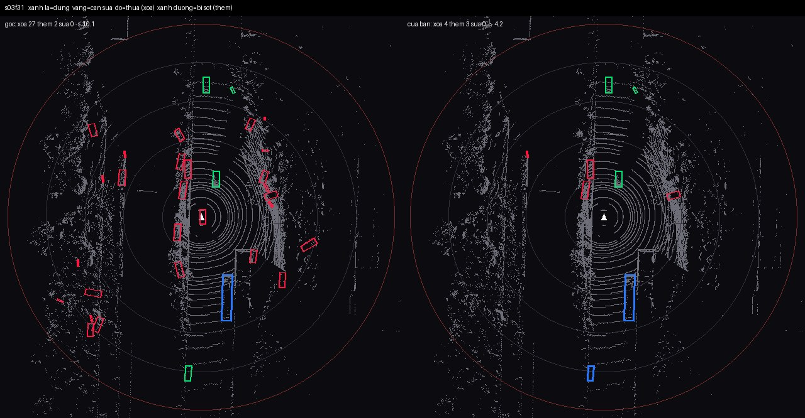

# Báo cáo Day 14 — Hoàng Quảng Quyền — 2A202603082

- Mã học viên dùng với `--student`: `082`
- `seed_tag` trong `frames_A.txt`: `<điền seed_tag>`

## 1. Dự đoán trước sweep (bước 5b)

- Tham số tôi nghĩ giảm công sửa nhiều nhất: `score_thr`
- Vì sao: Khi kiểm tra 3 frame tập A, tôi phải xóa nhiều
  box thừa hơn số box cần bổ sung do mô hình nhận diện
  nhầm đối tượng.

## 2. Tập A: sửa tay và tune

| Cấu hình | Xóa | Thêm | Sửa | Chi phí |
|---|---:|---:|---:|---:|
| Gốc | 54 | 6 | 0 | 22.2 |
| `best_config.json` | 5 | 13 | 0 | 14.5 |

- **Tham số đã đổi trong `best_config.json`:** Tăng `score_thr` từ 0.1 lên 0.5, giữ nguyên `min_points = 0`.

- **Kết quả leave-one-out:**
  - s01f07: cấu hình chọn `score_thr=0.5, min_points=0` → 4.3 (tốt nhất có thể 3.3).
  - s03f31: cấu hình chọn `score_thr=0.3, min_points=10` → 7.4 (tốt nhất có thể 4.2).
  - s05f44: cấu hình chọn `score_thr=0.5, min_points=0` → 6.0 (tốt nhất có thể 5.8).

- **Độ ổn định của cấu hình:** Cấu hình chưa ổn định hoàn toàn trên từng frame, đặc biệt là s03f31. Cấu hình `score_thr=0.5, min_points=0` được sử dụng cho tập B vì có tổng chi phí thấp nhất trên tập A, giảm từ 22.2 xuống 14.5, tương đương 34.68%. Tuy nhiên, kết quả mới chỉ được đánh giá trên 3 frame nên chưa thể khẳng định hiệu quả trên toàn bộ dữ liệu.
## 3. Trước/sau (bước 8)

- `scripts/pp_compare.py` báo giảm 35% công sửa trên tập A, từ 22.2 xuống 14.5.
- Sau khi tăng `score_thr` từ 0.1 lên 0.5, số box cần xóa giảm từ 54 xuống 5, số box cần thêm tăng từ 6 lên 13 và số box cần sửa vẫn là 0.
- Đối chiếu với dự đoán ở mục 1: [Đúng].

## 4. Tập B

Số đo từ `scripts/pp_prelabel.py --frames d14_082/frames_B.txt --config d14_082/best_config.json --gt d14_082/ref_B.json`:

| Xóa | Thêm | Sửa | Chi phí |
|---:|---:|---:|---:|
| 32 | 12 | 3 | 23.1 |

- Tổng số frame đã kiểm tra: 12/12.
- Số box trước khi sửa: 143.
- Số box sau khi sửa: 123.
- Số box khớp: 111.
- Loại thao tác tốn công nhất ở tập B là bổ sung box bị sót, với chi phí 12.0. Thao tác xóa box thừa diễn ra nhiều nhất với 32 box, tương ứng chi phí 9.6. Thao tác chỉnh sửa 3 box có chi phí 1.5.

## 5. Giới hạn

- Tập A chỉ có 3 frame để tối ưu tham số nên cấu hình được chọn chưa chắc phù hợp với toàn bộ dữ liệu.
- Mô hình được huấn luyện trên KITTI, không nhận diện trực tiếp các lớp Truck và Bus, đồng thời vẫn bỏ sót một số vật thể.
- Khi tăng `score_thr`, số box thừa giảm nhưng số box bị sót tăng, do đó vẫn cần kiểm tra và bổ sung thủ công.
- Chi phí sửa được tính theo công thức của bài lab, chưa phản ánh thời gian chỉnh sửa thực tế trên CVAT.